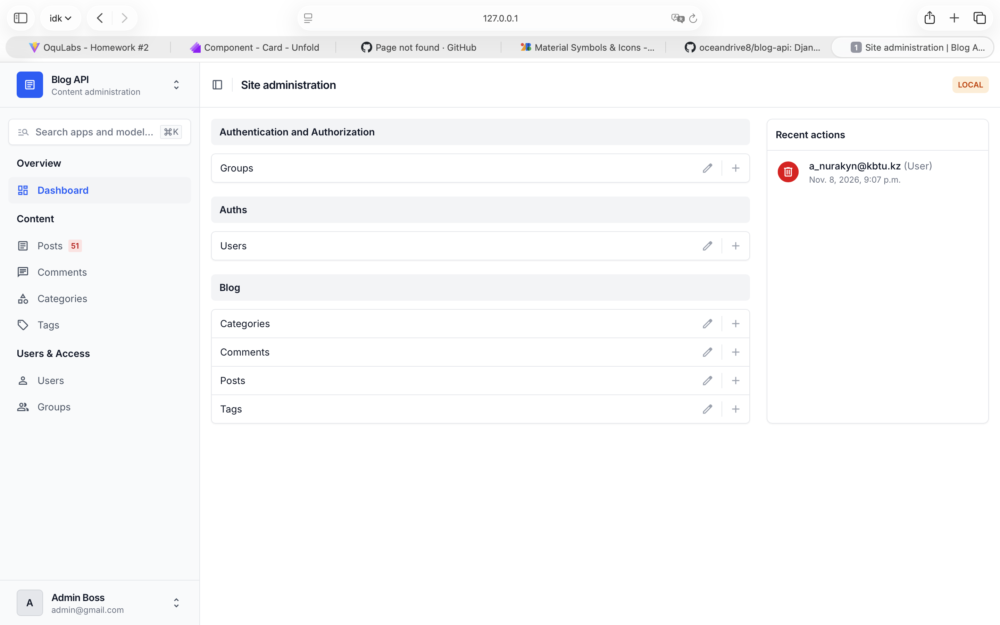
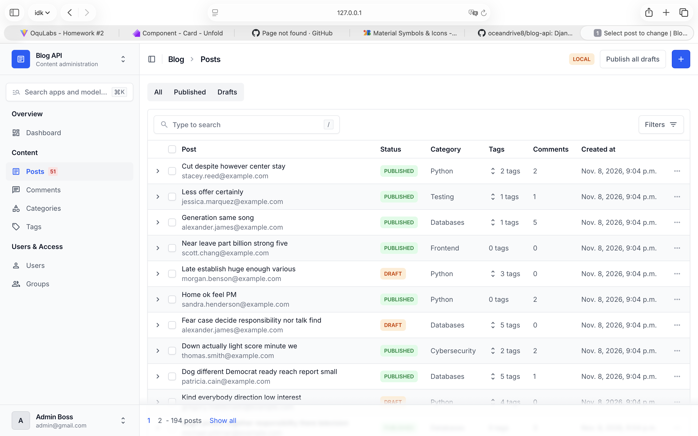
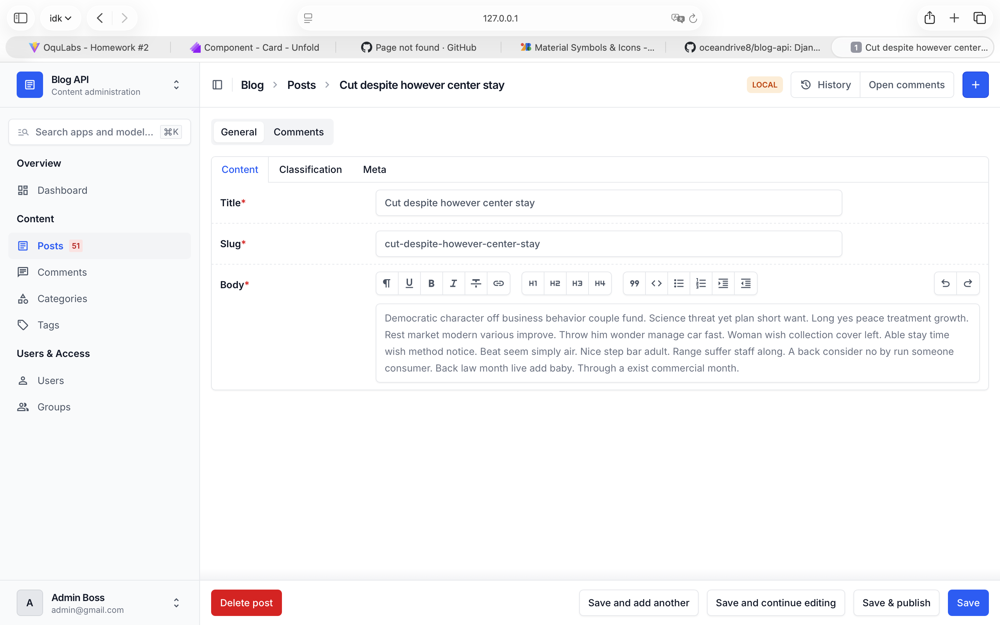
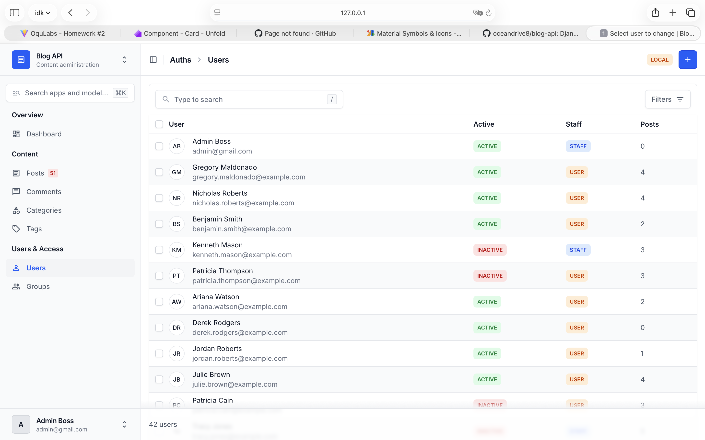

# Blog API

A blog backend built with Django and Django REST Framework. It has a custom
email-based user model, categories, tags, posts and comments, a management
command that fills the database with fake data, and an admin panel built with
[Django Unfold](https://unfoldadmin.com/).

## Tech stack

- Python 3.10+
- Django 5.2
- Django REST Framework and `djangorestframework-simplejwt`
- `python-decouple` for configuration from `.env`
- `django-unfold` for the admin theme
- `Faker` (development only) for seed data

## Project structure

```text
blog-api/
├── apps/
│   ├── auths/                  # custom User model (login by email) and its admin
│   └── blog/                   # Category, Tag, Post, Comment
│       ├── admin.py            # Unfold admin classes
│       ├── callbacks.py        # functions used by UNFOLD settings and the dashboard
│       └── management/commands/seed.py
├── settings/
│   ├── base.py                 # common settings, including UNFOLD
│   ├── conf.py                 # values read from .env
│   └── env/local.py            # local development settings
├── templates/admin/index.html  # admin dashboard
├── requirements/
│   ├── base.txt
│   └── dev.txt
├── docs/screenshots/           # images used in this README
└── manage.py
```

## Getting started

### 1. Clone and create a virtual environment

```bash
git clone https://github.com/oceandrive8/blog-api.git
cd blog-api
python3 -m venv .venv
source .venv/bin/activate        # Windows: .venv\Scripts\activate
```

### 2. Install dependencies

```bash
pip install -r requirements/dev.txt
```

`dev.txt` includes `base.txt` and adds Faker. For production use only
`requirements/base.txt`.

### 3. Configure the environment

Create a `.env` file in the project root:

```text
ENV_ID=local
```

Add any other variables your project needs in the same file (for example a secret
key). `BLOG_ENV_ID` controls the environment badge in the admin: `local` shows an
orange **Local** badge, any other value shows a red **Production** badge.

### 4. Run the project

On an empty database:

```bash
python manage.py migrate
python manage.py seed
python manage.py createsuperuser
python manage.py runserver
```

If `manage.py` does not already use the local settings, set them first:

```bash
export DJANGO_SETTINGS_MODULE=settings.env.local
```

Then open http://127.0.0.1:8000/admin/ and log in with the superuser you created.

## Seeding

One command fills every model: users, categories, tags, posts and comments.

```bash
python manage.py seed
```

### Arguments

| Argument     | Default | Description                         |
|--------------|---------|-------------------------------------|
| `--users`    | `20`    | Number of users to create           |
| `--posts`    | `100`   | Number of posts to create           |
| `--comments` | `500`   | Number of comments to create        |
| `--clear`    | off     | Delete existing data before seeding |

Show the built-in help:

```bash
python manage.py seed --help
```

### Example

```bash
python manage.py seed --clear --users 50 --posts 300 --comments 1500
```

```text
Users:        50 created
Categories:    8 created
Tags:         20 created
Posts:       300 created
Comments:   1500 created
Done in 2.41 seconds
```

### What gets created

- **Users:** names from Faker, unique emails, one shared password for all of them,
  some inactive users and a few staff users.
- **Categories and tags:** fixed lists of real names (about 8 categories and 20
  tags). Running the command again skips ones that already exist.
- **Posts:** random author, unique slug, about 70% published and 30% drafts, about
  10% without a category, and 0 to 5 random tags each.
- **Comments:** only on published posts, with a random author and 1 to 3 sentences.

### Notes

- `--clear` deletes comments, posts, tags, categories and all non-superuser users.
  **Superusers are kept.**
- Everything runs in one transaction. If the command fails, nothing is saved.
- All seeded users share the password stored in the `SEED_PASSWORD` constant in
  `apps/blog/management/commands/seed.py`. Use it for development only.

## Admin

The admin runs on Django Unfold and is configured in the `UNFOLD` dictionary in
`settings/base.py`.

### Global features

- Custom site title, header, subheader, icon and a `primary` color palette.
- Environment badge (**Local** or **Production**) based on `BLOG_ENV_ID`.
- Site dropdown with links to the GitHub repository and the Unfold docs.
- `Ctrl+K` / `Cmd+K` search over all models.
- Sidebar menu: **Overview** (Dashboard), **Content** (Posts, Comments,
  Categories, Tags) and **Users & Access** (Users, Groups, visible to superusers
  only). Posts shows a badge with the number of drafts.
- **All / Published / Drafts** tabs above the post list.

### Per model

| Model | What it has |
|---|---|
| Category, Tag | Slug filled from the name, search, sortable post count. A category row expands to show its posts. |
| Comment | Shortened body, filters by post, author and date range, search by body, author email and post title, autocomplete fields. |
| User | Header column with initials, colored active and staff labels, radio filters, tabbed edit form, add-user form, activate and deactivate actions. |
| Post | See below. |

### Post admin

- **List:** header column (title and author), colored status label, category, tags
  dropdown, sortable comment count and creation date. Filters (applied with a
  button) for status, category, tags, author and date range. Search by title, body
  and author email. Click a row to see its comments.
- **Actions:** publish selected and move to drafts (bulk), publish or unpublish a
  single row, publish all drafts, open a post's comments, and **Save & publish**.
- **Edit page:** tabs for Content, Classification and Meta. The slug fills from the
  title, author, category and tags use autocomplete, the body has a WYSIWYG editor,
  dates are read-only, there is a warning on unsaved changes, and comments appear
  inline in their own tab (10 per page).
- Queries are optimized with `select_related`, `prefetch_related` and `annotate`,
  so the number of SQL queries does not grow with the number of rows.

### Dashboard

The admin home page shows four user, published post, draft and comment cards, a bar
chart of posts per category, a table of the top 5 authors and progress bars for
published versus draft posts.

### Screenshots

**Dashboard**



**Post list with filters open**



**Post edit page**



**User list**



## Checking SQL queries

To check for N+1 queries, `settings/env/local.py` logs every SQL query to the
terminal (logger `django.db.backends`). Open a list page with 10 and then with 100
rows per page and compare the number of queries. It should be the same.

## Code standards

- PEP 8 and a linter
- Constants instead of magic numbers
- Sorted imports and clear naming
- Type hints
- `self.stdout.write` instead of `print` in management commands
