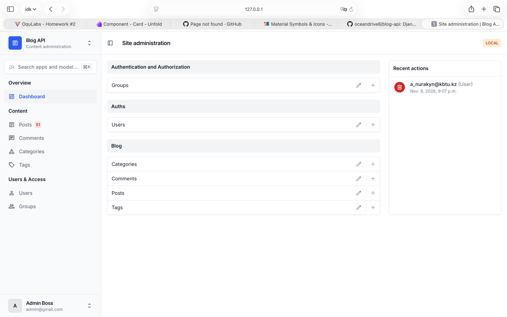
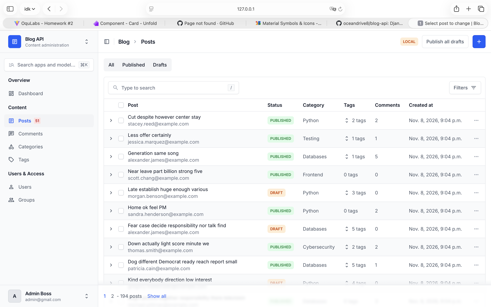
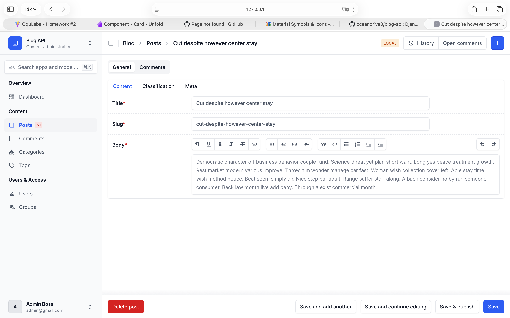
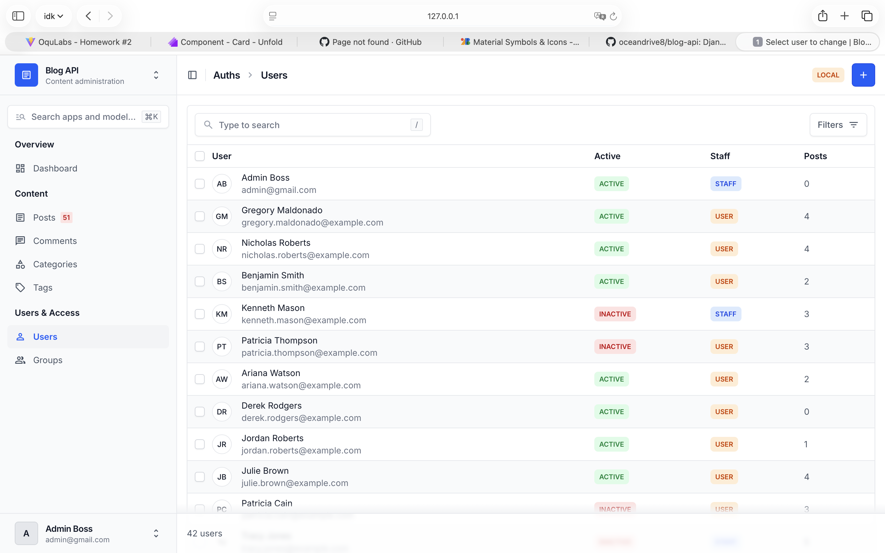

# Blog API

A blog backend built with Django and Django REST Framework. It has a custom
email-based user model, categories, tags, posts and comments, a management
command that fills the database with fake data, and an admin panel built with
[Django Unfold](https://unfoldadmin.com/).

## Tech stack

- Python 3.10+
- Django 5.2
- Django REST Framework and `djangorestframework-simplejwt`
- `python-decouple` for configuration from `.env`
- `django-unfold` for the admin theme
- `Faker` (development only) for seed data

## Project structure

```text
blog-api/
├── apps/
│   ├── auths/                  # custom User model (login by email) and its admin
│   └── blog/                   # Category, Tag, Post, Comment
│       ├── admin.py            # Unfold admin classes
│       ├── callbacks.py        # functions used by UNFOLD settings and the dashboard
│       └── management/commands/seed.py
├── settings/
│   ├── base.py                 # common settings, including UNFOLD
│   ├── conf.py                 # values read from .env
│   └── env/local.py            # local development settings
├── templates/admin/index.html  # admin dashboard
├── requirements/
│   ├── base.txt
│   └── dev.txt
├── docs/screenshots/           # images used in this README
└── manage.py
```

## Getting started

### 1. Clone and create a virtual environment

```bash
git clone https://github.com/oceandrive8/blog-api.git
cd blog-api
python3 -m venv .venv
source .venv/bin/activate        # Windows: .venv\Scripts\activate
```

### 2. Install dependencies

```bash
pip install -r requirements/dev.txt
```

`dev.txt` includes `base.txt` and adds Faker. For production use only
`requirements/base.txt`.

### 3. Configure the environment

Create a `.env` file in the project root:

```text
ENV_ID=local
```

Add any other variables your project needs in the same file (for example a secret
key). `BLOG_ENV_ID` controls the environment badge in the admin: `local` shows an
orange **Local** badge, any other value shows a red **Production** badge.

### 4. Run the project

On an empty database:

```bash
python manage.py migrate
python manage.py seed
python manage.py createsuperuser
python manage.py runserver
```

If `manage.py` does not already use the local settings, set them first:

```bash
export DJANGO_SETTINGS_MODULE=settings.env.local
```

Then open http://127.0.0.1:8000/admin/ and log in with the superuser you created.

## Seeding

One command fills every model: users, categories, tags, posts and comments.

```bash
python manage.py seed
```

### Arguments

| Argument     | Default | Description                         |
|--------------|---------|-------------------------------------|
| `--users`    | `20`    | Number of users to create           |
| `--posts`    | `100`   | Number of posts to create           |
| `--comments` | `500`   | Number of comments to create        |
| `--clear`    | off     | Delete existing data before seeding |

Show the built-in help:

```bash
python manage.py seed --help
```

### Example

```bash
python manage.py seed --clear --users 50 --posts 300 --comments 1500
```

```text
Users:        50 created
Categories:    8 created
Tags:         20 created
Posts:       300 created
Comments:   1500 created
Done in 2.41 seconds
```

### What gets created

- **Users:** names from Faker, unique emails, one shared password for all of them,
  some inactive users and a few staff users.
- **Categories and tags:** fixed lists of real names (about 8 categories and 20
  tags). Running the command again skips ones that already exist.
- **Posts:** random author, unique slug, about 70% published and 30% drafts, about
  10% without a category, and 0 to 5 random tags each.
- **Comments:** only on published posts, with a random author and 1 to 3 sentences.

### Notes

- `--clear` deletes comments, posts, tags, categories and all non-superuser users.
  **Superusers are kept.**
- Everything runs in one transaction. If the command fails, nothing is saved.
- All seeded users share the password stored in the `SEED_PASSWORD` constant in
  `apps/blog/management/commands/seed.py`. Use it for development only.

## Admin

The admin runs on Django Unfold and is configured in the `UNFOLD` dictionary in
`settings/base.py`.

### Global features

- Custom site title, header, subheader, icon and a `primary` color palette.
- Environment badge (**Local** or **Production**) based on `BLOG_ENV_ID`.
- Site dropdown with links to the GitHub repository and the Unfold docs.
- `Ctrl+K` / `Cmd+K` search over all models.
- Sidebar menu: **Overview** (Dashboard), **Content** (Posts, Comments,
  Categories, Tags) and **Users & Access** (Users, Groups, visible to superusers
  only). Posts shows a badge with the number of drafts.
- **All / Published / Drafts** tabs above the post list.

### Per model

| Model | What it has |
|---|---|
| Category, Tag | Slug filled from the name, search, sortable post count. A category row expands to show its posts. |
| Comment | Shortened body, filters by post, author and date range, search by body, author email and post title, autocomplete fields. |
| User | Header column with initials, colored active and staff labels, radio filters, tabbed edit form, add-user form, activate and deactivate actions. |
| Post | See below. |

### Post admin

- **List:** header column (title and author), colored status label, category, tags
  dropdown, sortable comment count and creation date. Filters (applied with a
  button) for status, category, tags, author and date range. Search by title, body
  and author email. Click a row to see its comments.
- **Actions:** publish selected and move to drafts (bulk), publish or unpublish a
  single row, publish all drafts, open a post's comments, and **Save & publish**.
- **Edit page:** tabs for Content, Classification and Meta. The slug fills from the
  title, author, category and tags use autocomplete, the body has a WYSIWYG editor,
  dates are read-only, there is a warning on unsaved changes, and comments appear
  inline in their own tab (10 per page).
- Queries are optimized with `select_related`, `prefetch_related` and `annotate`,
  so the number of SQL queries does not grow with the number of rows.

### Dashboard

The admin home page shows four user, published post, draft and comment cards, a bar
chart of posts per category, a table of the top 5 authors and progress bars for
published versus draft posts.

### Screenshots

**Dashboard**



**Post list with filters open**



**Post edit page**



**User list**



## Checking SQL queries

To check for N+1 queries, `settings/env/local.py` logs every SQL query to the
terminal (logger `django.db.backends`). Open a list page with 10 and then with 100
rows per page and compare the number of queries. It should be the same.

## Code standards

- PEP 8 and a linter
- Constants instead of magic numbers
- Sorted imports and clear naming
- Type hints
- `self.stdout.write` instead of `print` in management commands


## Queries (Homework 3)

The file `apps/blog/queries.py` holds 50 Django ORM queries, one function for each. The command `queries` runs them, shows the result and counts the SQL queries that Django sent to the database.

### Realistic dates

The `seed` command spreads the data over one year:

- every post gets a random `created_at` in the last 365 days;
- about 30% of posts get `updated_at` 1-30 days after `created_at` (never later than now), and the other posts have `updated_at` equal to `created_at`;
- every comment gets a random `created_at` between its post's `created_at` and now.

The dates are set in memory after `bulk_create` and saved with one `bulk_update`, because `auto_now_add` and `auto_now` overwrite any value during `bulk_create`.

### Running the queries

Fill the database first:

```bash
python manage.py seed --clear
```

| Command | What it does |
|---|---|
| `python manage.py queries` | Runs all queries except 40-44 (they change the data) |
| `python manage.py queries --number 31` | Runs only query 31. This also works for 40-44 |
| `python manage.py queries --number 6 --sql` | Also prints the SQL that Django sent to the database |

An unknown number gives a `CommandError`.

On an empty database:

```bash
python manage.py migrate
python manage.py seed
python manage.py queries
python manage.py queries --number 41
```

### Output

For every query the command prints the number, the function name, the number of SQL queries and the result. For a list or a QuerySet it prints the first 5 rows and the total number of rows. For model objects it also prints the values added with `annotate()`.

```text
$ python manage.py queries --number 31

31 categories_with_post_count - 1 SQL query
Python {'post_count': 24}
Cybersecurity {'post_count': 15}
Django {'post_count': 13}
DevOps {'post_count': 11}
Databases {'post_count': 10}
(8 rows)
```

```text
$ python manage.py queries --number 6 --sql

6 has_drafts - 1 SQL query
SELECT 1 AS "a" FROM "blog_post" WHERE "blog_post"."status" = 'draft' LIMIT 1
True
```

### Sample arguments

Queries that take arguments (a slug, an email, a number of days) get sample values from the dict `QUERY_ARGUMENTS` in `apps/blog/management/commands/queries.py`. Values that must exist in the database, such as an author's email, are taken from the database right before the query runs, so they are not counted as part of the query.

### The 50 queries

| Level | Queries | Topic |
|---|---|---|
| 1 | 1-7 | `filter`, `exclude`, `order_by`, slicing, `first`, `count`, `exists` |
| 2 | 8-14 | Field lookups (`icontains`, `iendswith`, `isnull`, `in`, `year`, `range`) |
| 3 | 15-21 | Queries across relations, `distinct`, multi-valued relations |
| 4 | 22-26 | `Q` and `F` objects |
| 5 | 27-28 | `values`, `values_list`, `Coalesce` |
| 6 | 29-30 | `aggregate` |
| 7 | 31-36 | `annotate`, `GROUP BY`, `HAVING` |
| 8 | 37-39 | `Concat`, `TruncMonth`, `Case` / `When` |
| 9 | 40-44 | `get_or_create`, `update`, `add`, `delete` |
| 10 | 45-47 | `select_related`, `prefetch_related`, `Prefetch` |
| 11 | 48-50 | `Subquery`, `OuterRef`, `Exists` |

### Notes

- Queries 40-44 **change the data**. The command runs them only with `--number`. To get fresh data, run `python manage.py seed --clear`.
- Every read query (1-39 and 48-50) makes exactly 1 SQL query. Queries 45, 46 and 47 are limited to 1, 2 and 2 SQL queries, and they use `select_related` and `prefetch_related` to avoid the N+1 problem.
- `settings/env/local.py` logs every SQL query to the terminal, so you may see extra SQL lines in the command output. This is normal.


## API

Base URL: `http://localhost:8000/api/blog/v1`

| Method | Endpoint | Auth | Description |
|---|---|---|---|
| GET | `/posts` | No | List published posts (paginated, filter with `?category=<slug>`) |
| POST | `/posts` | Yes | Create a post |
| GET | `/posts/{id}` | No | Post detail |
| PATCH | `/posts/{id}` | Yes (author or staff) | Update a post |
| DELETE | `/posts/{id}` | Yes (author or staff) | Delete a post |
| GET | `/posts/{id}/comments` | No | List comments of a post |
| POST | `/posts/{id}/comments` | Yes | Add a comment |
| GET | `/categories` | No | List categories (cached for 10 minutes) |
| GET | `/tags` | No | List tags (cached for 10 minutes) |

Auth base URL: `http://localhost:8000/api/auths/v1`  <!-- TODO: check the prefix in settings/urls.py -->

| Method | Endpoint | Description |
|---|---|---|
| POST | `/token/refresh` | Get a new access token from a refresh token |
| - | `/users`, `/users/{id}` | User endpoints (`UserViewSet`) <!-- TODO: list the real actions --> |

### How to get a token

```bash
# TODO: replace the URL and fields with your real login/register endpoint
curl -X POST http://localhost:8000/api/auths/v1/users/login \
  -H "Content-Type: application/json" \
  -d '{"email": "user@example.com", "password": "your-password"}'
```

The response contains an `access` and a `refresh` token. Send the access token with every protected request:

```bash
curl -X POST http://localhost:8000/api/blog/v1/posts \
  -H "Authorization: Bearer <access>" \
  -H "Content-Type: application/json" \
  -d '{"title": "My post", "body": "Text"}'
```

When the access token expires:

```bash
curl -X POST http://localhost:8000/api/auths/v1/token/refresh \
  -H "Content-Type: application/json" \
  -d '{"refresh": "<refresh>"}'
```

## Redis and Celery

Redis is used for caching and as the Celery broker.

```bash
# first time
docker run -d --name blog-redis -p 6379:6379 redis

# later
docker start blog-redis

# check
docker exec -it blog-redis redis-cli ping    # PONG
```

Start the Celery worker (project root, venv active, Redis running):

```bash
celery -A settings worker -l info
```

Start the server in another terminal:

```bash
python manage.py runserver
```

Check the cache: call `GET /categories`, then run
`docker exec -it blog-redis redis-cli KEYS "*"`. You should see `:1:categories`.
